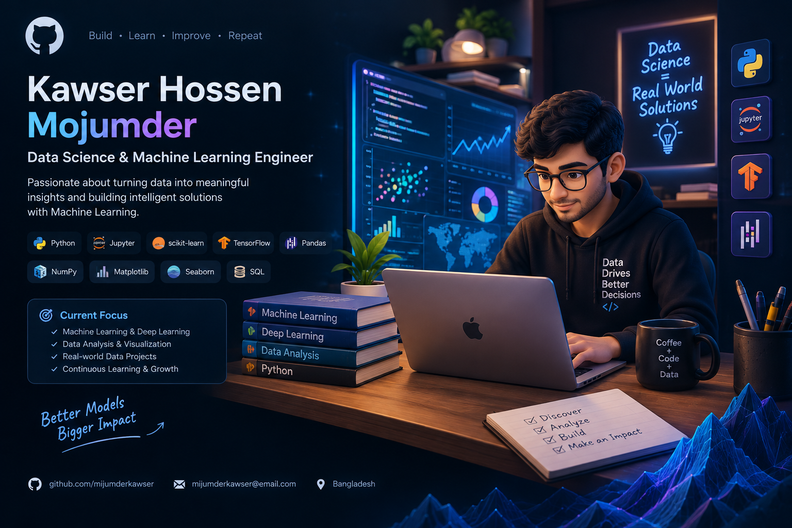

# 👋 Hi, I'm Kawser Hossen Mojumder

### 🧠 Data Science | Machine Learning | Deep Learning

---

## 🚀 About Me

I'm passionate about **Data Science and Machine Learning**. I enjoy working with data, discovering patterns, developing predictive models, and learning new technologies to solve real-world problems.

- 🧠 Interested in Data Science and Machine Learning
- 🐍 Exploring Python for data analysis and modeling
- 📊 Learning data preprocessing and visualization
- 🤖 Exploring Deep Learning and Artificial Intelligence
- 🌱 Always learning, experimenting, and building projects

## 🛠️ Technologies & Tools

  

## 💡 My Interests

<table>
<tr>
<td align="center" width="33%">

### 🧹
**Data Preparation**

Cleaning and transforming data

</td>
<td align="center" width="33%">

### 🧠
**Machine Learning**

Training and evaluating models

</td>
<td align="center" width="33%">

### 🔬
**Deep Learning**

Exploring neural networks

</td>
</tr>
</table>

## 📌 Projects

Explore my repositories for my latest projects, experiments, and learning journey.

## 📊 GitHub Stats

---

### 🌌 Learn • Build • Experiment • Improve

**Turning curiosity into knowledge, and knowledge into intelligent solutions.**

